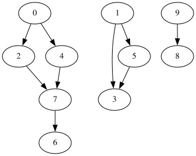
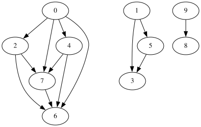

# Parallel Transitive Closure of Directed Graphs (OpenMP)

Parallel computation of the **transitive closure** of a directed graph with Warshall's algorithm, as the first step toward finding its connected components. The sequential O(n³) reference is parallelised with OpenMP, including a cache-blocked variant, and validated bit-for-bit against the sequential output.

Course project, Université de Strasbourg (2022–2023), based on Alves et al., *Parallel transitive closure algorithm* [1].

## Problem

A graph is stored as an n × n adjacency matrix, where `a[i][j] = 1` means there is an edge `i → j`. The transitive closure adds an edge `i → j` whenever a path from `i` to `j` exists:

```
c[i][j] = c[i][j] OR (c[i][k] AND c[k][j])      for k, i, j in 0..n-1
```

Once the closure is known, connected components are straightforward to extract.

<p align="center">
  
  &nbsp;&nbsp;&nbsp;
  
</p>
<p align="center"><em>Left: input graph with 3 components. Right: the same graph after transitive closure.</em></p>

## Implementation

| File | Content |
|---|---|
| `graph.c` | Sequential Warshall reference |
| `graph_par.c` | OpenMP versions: `warshall_par` (dynamic schedule), `warshall_col` (static schedule) and **`warshall_versionB`**, the one used by default:, a 32×32 cache-blocked version with parallel initialisation (`collapse(2)`) |
| `util.c` | Input parsing (adjacency matrix or edge list), output, connected-component extraction |
| `gen_adj.py`, `gen_pairs.py` | Synthetic graph generators with a chosen number of components |
| `convert_*_to_dot.c` | Export to Graphviz `dot` for visualisation |

Blocking keeps the working rows of `c` in cache across several values of `k`, which matters once the matrix no longer fits in L2/L3 (a 10,000-vertex graph is a 400 MB `int` matrix).

## Build and run

Requires gcc with OpenMP and Python 3 (data generation).

```bash
make graph graph_par
make test-seq-1000           # generates share/1000x1000.adj and runs the sequential version
make test-pc-1000            # runs the parallel and sequential versions on the same input
```

Manual runs:

```bash
./graph_par -i share/10x10.adj -t adj  > closure.adj     # adjacency-matrix input
./graph_par -i share/pairs_1000.txt -t pairs > closure.adj  # edge-list input (tab-separated)
```

Timing and progress go to `stderr`, the closure matrix to `stdout`.

## Validation

The parallel output is compared with the sequential one by checksum (`md5sum`); reference checksums for the 3000 and 10,000-vertex datasets are listed in [`share/md5sums`](share/md5sums). Components can be cross-checked with Graphviz:

```bash
./convert_adj_to_dot share/10x10.adj
ccomps -s -v share/10x10.adj.dot
```

## References

[1] Alves, C.E.R., Cáceres, E.N., de Castro, A.A. et al. *Parallel transitive closure algorithm.* J Braz Comput Soc 19, 161–166 (2013). https://doi.org/10.1007/s13173-012-0089-z (PDF in [`biblio/`](biblio/))

## Author

**Ahmed Taleb Bechir**
[atbechir.com](https://atbechir.com) · [LinkedIn](https://www.linkedin.com/in/ahmed-taleb-bechir-97a7301a4) · [GitHub](https://github.com/talebbechir123)
